# ConnectHub | Plataforma de Integrações

[](https://github.com/caiorocha7/connecthub-integrations/actions/workflows/ci.yml)

O **ConnectHub** recebe webhooks de sistemas externos, valida a autenticidade de cada um, transforma o JSON
de forma configurável e o entrega a um ou mais destinos HTTP. As entregas são **assíncronas**, **idempotentes**,
**retentadas com backoff exponencial** e **rastreáveis** em um dashboard Angular.

O projeto foi construído para mostrar como uma integração se comporta quando o destino cai. Ele inclui um
**simulador de falhas** (HTTP 500, timeout, 429) e um script que reproduz o ciclo completo: falha, retentativas,
reprocessamento, sucesso e bloqueio de duplicados. O script roda contra API, banco e worker reais.

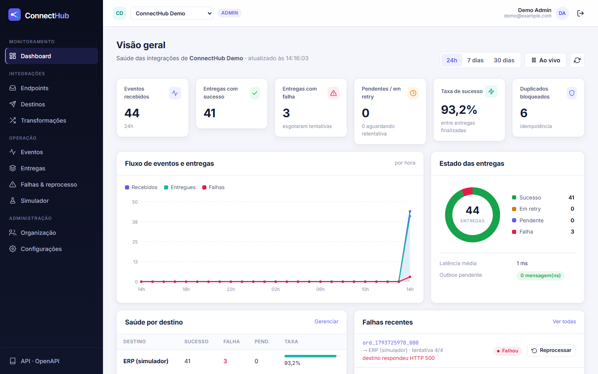

---

## Sumário

- [Problema resolvido](#problema-resolvido)
- [Funcionalidades](#funcionalidades)
- [Stack](#stack)
- [Arquitetura](#arquitetura)
- [Fluxo completo de um webhook](#fluxo-completo-de-um-webhook)
- [Como executar localmente](#como-executar-localmente)
- [Credenciais de demonstração](#credenciais-de-demonstração)
- [Testes](#testes)
- [Reproduzir falhas e recuperação](#reproduzir-falhas-e-recuperação)
- [Decisões de arquitetura](#decisões-de-arquitetura)
- [API](#api)
- [Screenshots](#screenshots)
- [Limitações do MVP e próximos passos](#limitações-do-mvp-e-próximos-passos)

## Problema resolvido

Integrar sistemas por webhook parece simples até algo dar errado:

- o destino fica fora do ar ou responde `429`, e o evento se perde;
- a origem reenvia o mesmo evento e o pedido é faturado duas vezes;
- o evento é gravado, mas a mensagem nunca chega à fila;
- ninguém sabe dizer **o que** foi entregue, **quando** e **por que** falhou;
- cada destino exige um formato de payload diferente.

O ConnectHub ataca cada um desses pontos com mecanismos explícitos: outbox transacional, chave de idempotência,
claim/lock de entregas, retentativas classificadas por tipo de erro, histórico completo e transformação declarativa.

## Funcionalidades

| Área | O que está implementado |
| --- | --- |
| **Autenticação** | Registro, login, logout. Access token JWT curto (15 min), refresh token opaco **rotativo** com detecção de reuso, senhas com **Argon2**. |
| **Multi-tenant** | Organizações e membros com papéis **ADMIN** e **OPERATOR**. Todas as consultas são filtradas por `organization_id`; recursos de outros tenants respondem `404`. |
| **Endpoints** | CRUD, URL pública única (`/api/v1/ingest/{public_id}`), segredo HMAC cifrado em repouso (Fernet), revelação auditada e **rotação com período de carência**. |
| **Destinos** | CRUD de destinos HTTP com método, headers permitidos, timeout, limite de tentativas, assinatura opcional da entrega e ativação/desativação. |
| **SSRF** | Bloqueio de IPs privados, loopback, link-local, CGNAT e **metadados de nuvem**. Redirecionamentos não são seguidos. A URL é validada no cadastro e de novo a cada entrega. Há allowlist para o simulador em dev. |
| **Ingestão** | HMAC-SHA256 sobre o **corpo bruto**, comparação em tempo constante, janela anti-replay de 5 min, limite de payload (256 KB), `415`/`400`/`401`/`404`/`413` coerentes. O evento é persistido **antes** do `202`. |
| **Transformação** | Regras declarativas: renomear, selecionar caminhos (`data.items[0].sku`), constantes, valores padrão, conversões (texto, inteiro, decimal, booleano, data ISO), `trim`/`lower`/`upper` e campos obrigatórios. Pré-visualização ao vivo. **Sem `eval`/`exec`.** |
| **Entrega** | Worker Celery independente da API. Backoff exponencial com jitter, respeito a `Retry-After`, classificação de erros (timeout, rede, 429, 5xx = temporários; 4xx, redirect, SSRF, transformação = permanentes). |
| **Idempotência** | Chave `(organização, endpoint, id do evento)`. Duplicados retornam `200 duplicate=true` e **não** criam nova entrega. Há uma entrega lógica única por `(evento, destino)`. |
| **Outbox** | O evento, as entregas e as mensagens de outbox são gravados na mesma transação. Um relay publica no Redis e um job de recuperação trata worker morto e mensagem perdida. |
| **Reprocessamento** | Manual por entrega, por evento ou em lote, liberado para ADMIN e OPERATOR e registrado na auditoria. |
| **Observabilidade** | Dashboard com KPIs, gráfico temporal, distribuição de estados e saúde por destino, com atualização automática. Histórico paginado e filtrável (estado, período, endpoint, destino, ID). Logs JSON correlacionados por `request_id`, `event_id` e `delivery_id`. |
| **Simulador** | Destino controlável: normal, 5xx configurável, timeout, 429 com `Retry-After`, "falhar as próximas N" e histórico de requisições recebidas. |

## Stack

| Camada | Tecnologias |
| --- | --- |
| Frontend | Angular 21 (standalone, signals, zoneless), TypeScript, Angular Router, Reactive Forms, SCSS próprio, gráficos SVG sem dependências |
| API | Python 3.12, FastAPI, SQLAlchemy 2, Pydantic 2, Alembic |
| Worker | Celery 5 (worker + beat), Redis 7 como broker |
| Banco | PostgreSQL 16 (fonte da verdade de todo o estado) |
| Simulador | FastAPI (serviço separado) |
| Infra | Docker, Docker Compose (healthchecks, volumes, migrations), Nginx (SPA + reverse proxy), GitHub Actions |
| Qualidade | Pytest (62 testes, 89% de cobertura no backend), Vitest (frontend), Ruff, mypy `--strict`, Prettier; smoke de navegador (Puppeteer) validado localmente |

## Arquitetura

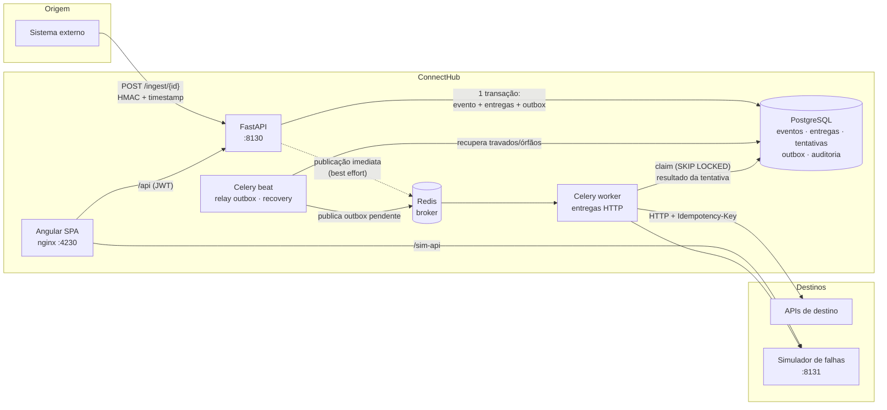

A arquitetura em detalhes (modelo de dados, máquinas de estado e concorrência) está em
[docs/architecture.md](docs/architecture.md).

## Fluxo completo de um webhook

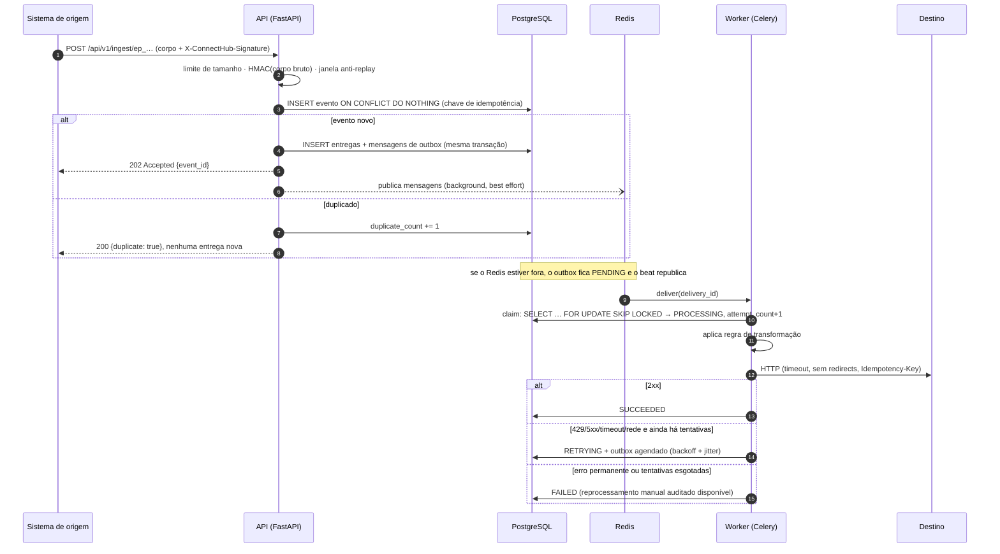

## Como executar localmente

**Pré-requisitos:** Docker com Compose v2. Para rodar os testes fora de containers: Python 3.12 e Node 22.

```bash
git clone https://github.com/caiorocha7/connecthub-integrations.git
cd connecthub-integrations
cp .env.example .env              # valores apenas para desenvolvimento
docker compose up -d --build --wait
```

| Serviço | URL padrão |
| --- | --- |
| Interface web | http://localhost:4230 |
| API + OpenAPI (Swagger) | http://localhost:8130/docs |
| Simulador de falhas | http://localhost:8131/docs |
| PostgreSQL / Redis | `localhost:5442` / `localhost:6392` |

As portas não são as convencionais (5432, 6379, 8000…) para não conflitar com outros projetos da máquina.
Todas podem ser alteradas no `.env` (`CH_*_PORT`). O Compose usa o nome de projeto `connecthub`, então
containers e volumes ficam isolados.

O serviço `migrate` roda `alembic upgrade head` e o seed de demonstração antes de API e worker subirem.

```bash
docker compose ps                      # estado e healthchecks
docker compose logs -f worker          # logs JSON correlacionados
python scripts/generate_traffic.py     # popula o dashboard com tráfego real (requer httpx)
docker compose down                    # parar (mantém os dados)
docker compose down -v                 # parar e apagar os volumes DESTE projeto
```

Para desenvolver sem Docker para a API e o frontend, mantendo apenas a infraestrutura em containers:

```bash
docker compose up -d postgres redis simulator
cd backend && python -m venv .venv && .venv/Scripts/pip install -r requirements-dev.txt   # Linux/macOS: .venv/bin
alembic upgrade head && python -m app.seed
uvicorn app.main:app --port 8130 --reload
celery -A app.worker.celery_app worker -Q deliveries,maintenance -P solo   # em outro terminal
celery -A app.worker.celery_app beat                                       # em outro terminal
cd ../frontend && npm ci && npm start      # http://localhost:4200, com proxy para a API e o simulador
```

## Credenciais de demonstração

O seed cria **apenas para desenvolvimento** (ele se recusa a rodar com `ENVIRONMENT=production`):

| Campo | Valor padrão | Variável |
| --- | --- | --- |
| E-mail | `demo@example.com` | `DEMO_USER_EMAIL` |
| Senha | `Demo@12345` | `DEMO_USER_PASSWORD` |

O seed também cria a organização "ConnectHub Demo", um endpoint, uma regra de transformação e um destino apontando
para o simulador. Nenhum segredo real é versionado: `.env` está no `.gitignore` e o `.env.example` traz só valores
de desenvolvimento.

## Testes

| Suíte | Comando | Resultado verificado |
| --- | --- | --- |
| Backend (unit + integração com PostgreSQL real e Redis real) | `cd backend && pytest --cov=app` | **62 passaram**, cobertura **89%** |
| Lint e tipos do backend | `ruff check app tests && ruff format --check app tests && mypy app` | sem apontamentos (`mypy --strict`) |
| Migrations × modelos | `alembic upgrade head && alembic check` | sem divergências |
| Simulador | `cd simulator && pytest` | **5 passaram** |
| Frontend (Vitest via `ng test`) | `cd frontend && npm run test:ci` | **16 passaram** |
| Frontend (formato, tipos, build) | `npm run format:check && npm run typecheck && npm run build` | ok |
| End-to-end de resiliência (stack Docker real) | `python tests/e2e/demo_scenario.py` | **10 passos + bônus ok** |
| Smoke de UI em navegador (Chrome headless, **apenas local**) | `cd tests/e2e && npm i && node ui_smoke.mjs` | validado localmente: todas as telas sem erros de console/API |

Os testes do backend criam e migram o banco `connecthub_test` automaticamente. Use `TEST_DATABASE_URL` e
`REDIS_URL` para apontar para outra instância. O que é coberto:

- cadastro, login, refresh rotativo com detecção de reuso, logout e troca de senha;
- **isolamento entre organizações** e permissões ADMIN/OPERATOR;
- HMAC válido, inválido, adulterado, sem headers e fora da janela; rotação de segredo com carência;
- **idempotência** (payload, header, hash do corpo) e eventos repetidos;
- transformação JSON e rejeição de regras inseguras ou inválidas;
- **publicação real no Redis e consumo por um worker Celery real**;
- retentativas, backoff, `Retry-After`, timeout, erro de rede, 4xx permanente, redirect bloqueado e esgotamento;
- **claim concorrente** (4 workers, 1 entrega);
- reprocessamento manual (entrega e evento) com auditoria;
- **evento persistido com broker indisponível**, publicado depois pelo relay; recuperação de worker morto e de
  mensagem perdida;
- histórico, filtros, paginação, mascaramento e métricas do dashboard;
- SSRF no cadastro e no momento da entrega.

A CI ([.github/workflows/ci.yml](.github/workflows/ci.yml)) roda em push e pull request quatro jobs: **backend**
(lint, tipos, `alembic check` e testes com PostgreSQL e Redis como services), **frontend** (formato, tipos, testes
e build), **simulador** (lint e testes) e **E2E** (sobe a stack completa via Docker Compose e executa o cenário
de resiliência). Qualquer falha reprova o pipeline. O smoke visual com Chrome/Puppeteer (`tests/e2e/ui_smoke.mjs`)
**não faz parte da CI**: ele depende de um Chrome instalado e foi validado localmente.

## Reproduzir falhas e recuperação

O roteiro passo a passo, pela UI e via script, está em [docs/demo.md](docs/demo.md). Resumo do caminho automatizado:

```bash
docker compose up -d --build --wait
pip install -r tests/e2e/requirements.txt
python tests/e2e/demo_scenario.py
```

O script cria a organização, o endpoint e o destino; coloca o simulador em HTTP 500; envia um webhook assinado e
acompanha as 3 tentativas com backoff até `FAILED`. Depois restaura o simulador, reprocessa a entrega (a ação fica
auditada) e confirma o `SUCCEEDED`. Em seguida reenvia o mesmo `id` e comprova que **nenhuma entrega nova** foi
criada e que o destino recebeu exatamente **um** 2xx. Como bônus, mostra uma falha transitória (2×503) curada por
retry automático.

## Decisões de arquitetura

### Idempotência e a verdade sobre "exactly-once"

O ConnectHub garante **processamento lógico idempotente** e **entrega at-least-once**. Ele **não** promete
exactly-once de efeitos externos, porque isso é impossível sem a cooperação do destino:

- **Na entrada**, a constraint única `(organization_id, endpoint_id, external_event_id)` com
  `INSERT … ON CONFLICT DO NOTHING` faz um evento repetido virar só um contador (`duplicate_count`). Não surgem
  novas entregas.
- **Na entrega**, há uma entrega lógica por `(evento, destino)` (constraint única), e cada tentativa tem
  `(delivery_id, attempt_number)` único.
- **No destino**, se o worker enviar a requisição e cair (ou der timeout) depois que o destino processou, a
  tentativa será repetida. Por isso toda requisição leva `Idempotency-Key: <delivery_id>`, estável entre
  tentativas, para o destino deduplicar o efeito.

### Outbox transacional

A API grava o evento, as entregas e as mensagens de outbox **em uma única transação**. Só depois responde `202` e
tenta publicar no Redis em background. Se o Redis estiver fora ou a API cair logo após o commit, a mensagem continua
`PENDING`, e o **relay** (Celery beat, a cada 2 s) a publica com `FOR UPDATE SKIP LOCKED`. O cenário "evento
persistido mas não enfileirado" não perde dados; no pior caso, a entrega atrasa.

As **retentativas reutilizam o mesmo mecanismo**: o worker grava uma mensagem de outbox com
`available_at = next_attempt_at`. O PostgreSQL continua sendo a fonte da verdade e não há dependência de tarefas
`eta` guardadas na memória do worker.

### Claim/lock e concorrência

Mensagens duplicadas no broker são esperadas (relay e publicação imediata, `acks_late`, recuperação). O worker
reivindica a entrega com `SELECT … FOR UPDATE SKIP LOCKED` filtrando `status IN (PENDING, RETRYING)` e
`next_attempt_at <= now`, e então a marca como `PROCESSING` com `locked_by` e `locked_until`. Só um worker vence; os
demais viram *no-op*. A chamada HTTP acontece **fora** de transação, e a finalização só grava se o lock ainda
pertencer ao worker. O status agregado do evento é recalculado com o evento bloqueado (`FOR UPDATE`), o que evita
*lost updates* entre entregas paralelas do mesmo evento.

### Retentativas

- Backoff `min(cap, base · 2^(n-1))` com **equal jitter** (entre 50% e 100% do valor). `Retry-After` é respeitado
  como piso. Base, teto e limite de tentativas são configuráveis.
- **Temporários:** timeout, erro de rede, `408`, `425`, `429` e `5xx`.
- **Permanentes:** demais `4xx`, `3xx` (redirects não são seguidos), URL bloqueada por SSRF e erro de transformação.
- O **reprocessamento manual** reabre uma entrega `FAILED` com um novo orçamento de tentativas. O histórico é
  mantido, a tentativa é marcada como `MANUAL` e a ação vai para `audit_logs`.

### Recuperação

O job `recover` roda a cada 30 s. Ele marca como `worker_lost` as tentativas de entregas presas em `PROCESSING` com
lock expirado e as reagenda. Também reenfileira entregas pendentes que estão sem mensagem de outbox há mais de
60 s, o caso de uma mensagem perdida no broker.

### Segurança

- Segredos de endpoint ficam **cifrados** (Fernet). São exibidos uma vez na criação e depois só por ADMIN, com
  auditoria.
- Payloads e headers expostos pela API passam por **mascaramento** recursivo (`password`, `token`, `cpf`, `card…`).
- Erros públicos não revelam segredos nem stack traces. Login com e-mail inexistente leva o mesmo tempo e devolve a
  mesma mensagem que senha errada.
- O frontend acessa API e simulador pela mesma origem via nginx, sem CORS aberto em produção.

## API

A documentação interativa (OpenAPI 3) fica em **http://localhost:8130/docs**, ou `/docs` pela interface web. O
resumo dos endpoints e exemplos de assinatura estão em [docs/api.md](docs/api.md).

| Método | Rota | Descrição |
| --- | --- | --- |
| `POST` | `/api/v1/ingest/{public_id}` | Ingestão pública de webhook (HMAC) |
| `POST` | `/api/v1/auth/register` · `login` · `refresh` · `logout` | Sessão |
| `GET` | `/api/v1/orgs/{org}/dashboard/summary?hours=24` | KPIs, série temporal e saúde |
| `CRUD` | `/api/v1/orgs/{org}/endpoints` · `destinations` · `transform-rules` | Configuração |
| `POST` | `/api/v1/orgs/{org}/endpoints/{id}/rotate-secret` | Rotação de segredo |
| `GET` | `/api/v1/orgs/{org}/events` · `deliveries` | Histórico filtrável |
| `POST` | `/api/v1/orgs/{org}/deliveries/{id}/replay` | Reprocessamento manual |

## Screenshots

As capturas abaixo são **reais**: foram tiradas da aplicação rodando via Docker Compose, com dados gerados por
`scripts/generate_traffic.py` e `tests/e2e/demo_scenario.py` (Chrome headless, `tests/e2e/ui_smoke.mjs`). Os
arquivos ficam em [docs/screenshots/](docs/screenshots/). Para atualizá-las, rode o smoke de UI e substitua os PNGs.

| | |
| --- | --- |
| 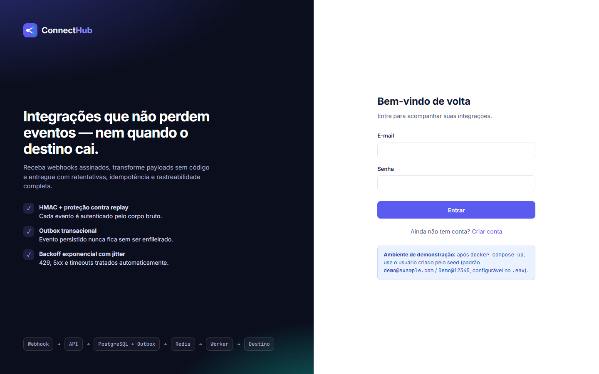 Login | 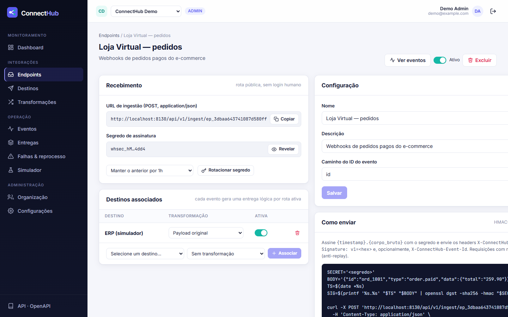 Detalhe do endpoint |
| 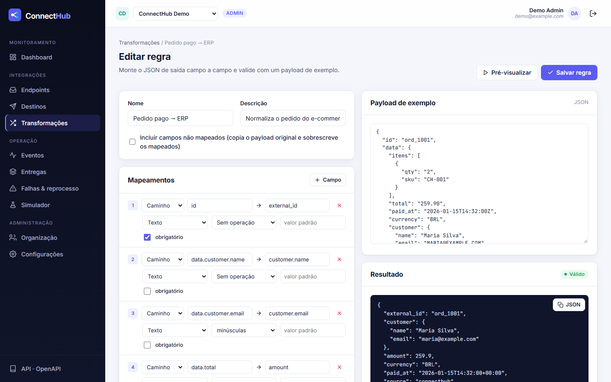 Editor de transformação | 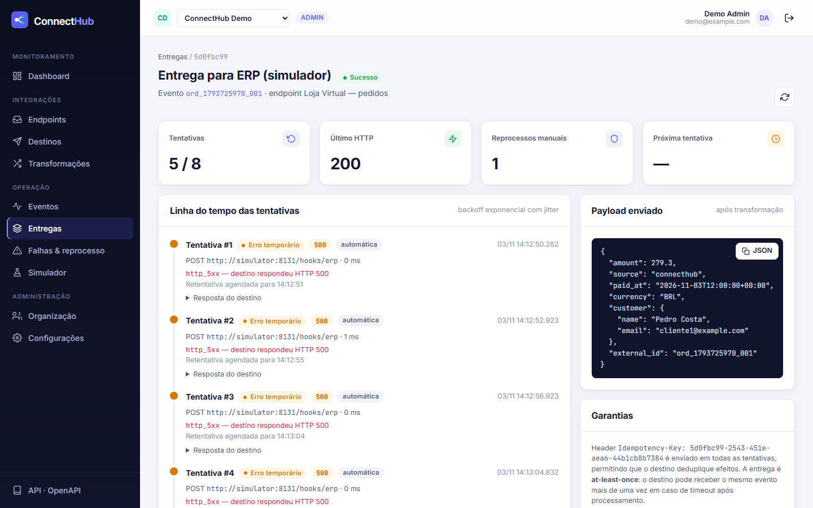 Linha do tempo de tentativas |
| 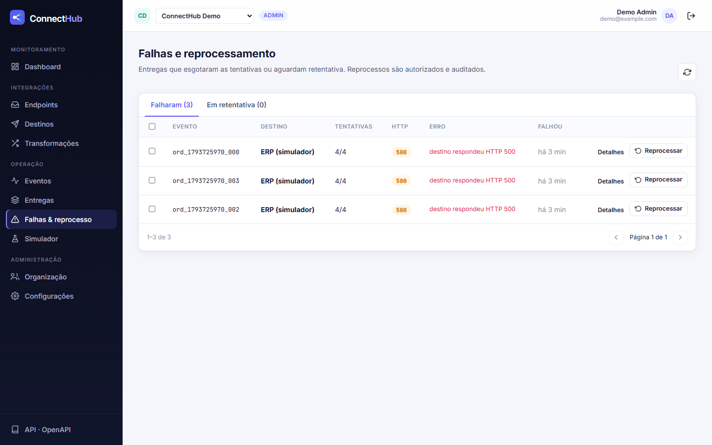 Falhas e reprocessamento | 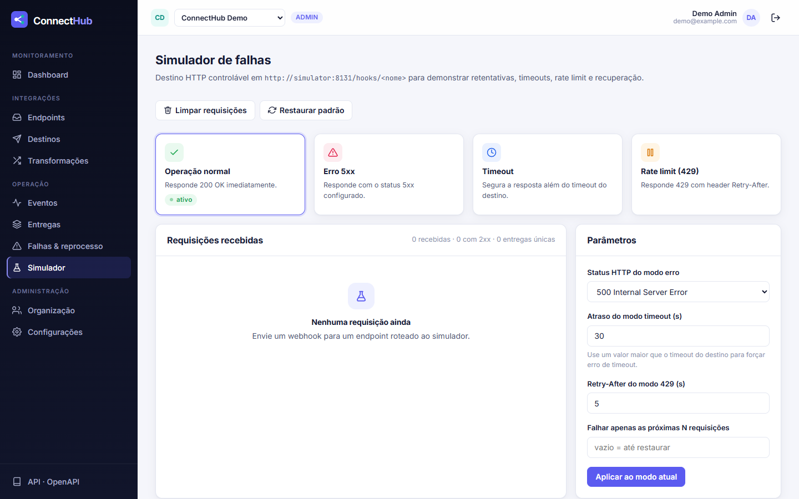 Simulador de falhas |
| 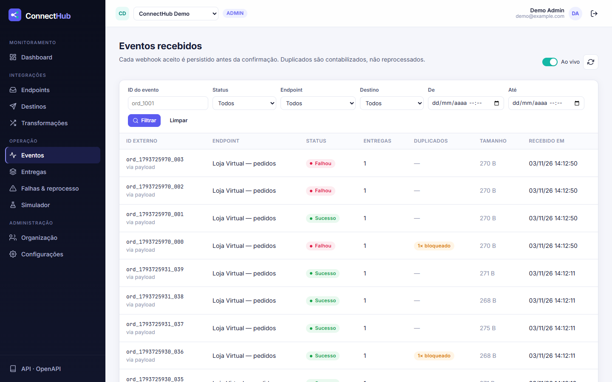 Eventos recebidos | 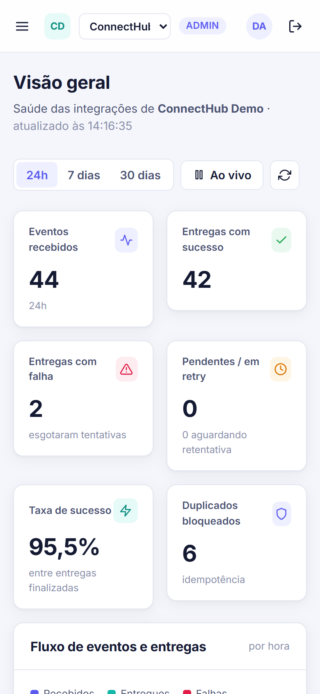 Layout responsivo |

## Limitações do MVP e próximos passos

Limitações conhecidas, documentadas de forma honesta:

- **Exactly-once de efeito externo não é garantido.** A entrega é at-least-once com `Idempotency-Key`.
- **Ordem de entrega não é garantida** entre eventos do mesmo endpoint. Eventos independentes podem ultrapassar uns
  aos outros durante as retentativas.
- **DNS rebinding:** a URL é validada no cadastro e de novo a cada entrega, mas a resolução DNS do httpx é separada
  da validação. Fixar o IP resolvido na conexão é uma melhoria planejada.
- **Revogação de access token:** o logout revoga o refresh token. O access token (15 min) expira naturalmente; não
  há denylist.
- **Rate limiting** da rota pública de ingestão não está implementado e deve ficar no gateway ou no edge.
- **Retenção:** o payload completo é guardado indefinidamente, limitado a 256 KB por evento. Mensagens de outbox
  publicadas são expurgadas após 7 dias.
- O simulador guarda estado em memória (processo único), por design: é uma ferramenta de demonstração.
- Tokens ficam em `localStorage`. Em produção, prefira cookie `HttpOnly` + `SameSite` para o refresh token.

Próximos passos: dead-letter com alertas (e-mail ou Slack), métricas Prometheus e tracing OpenTelemetry, ordenação
opcional por chave de partição, transformações com templates e condicionais, convites por e-mail para membros,
rate limit por endpoint, retenção configurável e particionamento das tabelas de eventos.

---

Projeto de portfólio. Todos os dados, credenciais e domínios usados aqui são fictícios.
