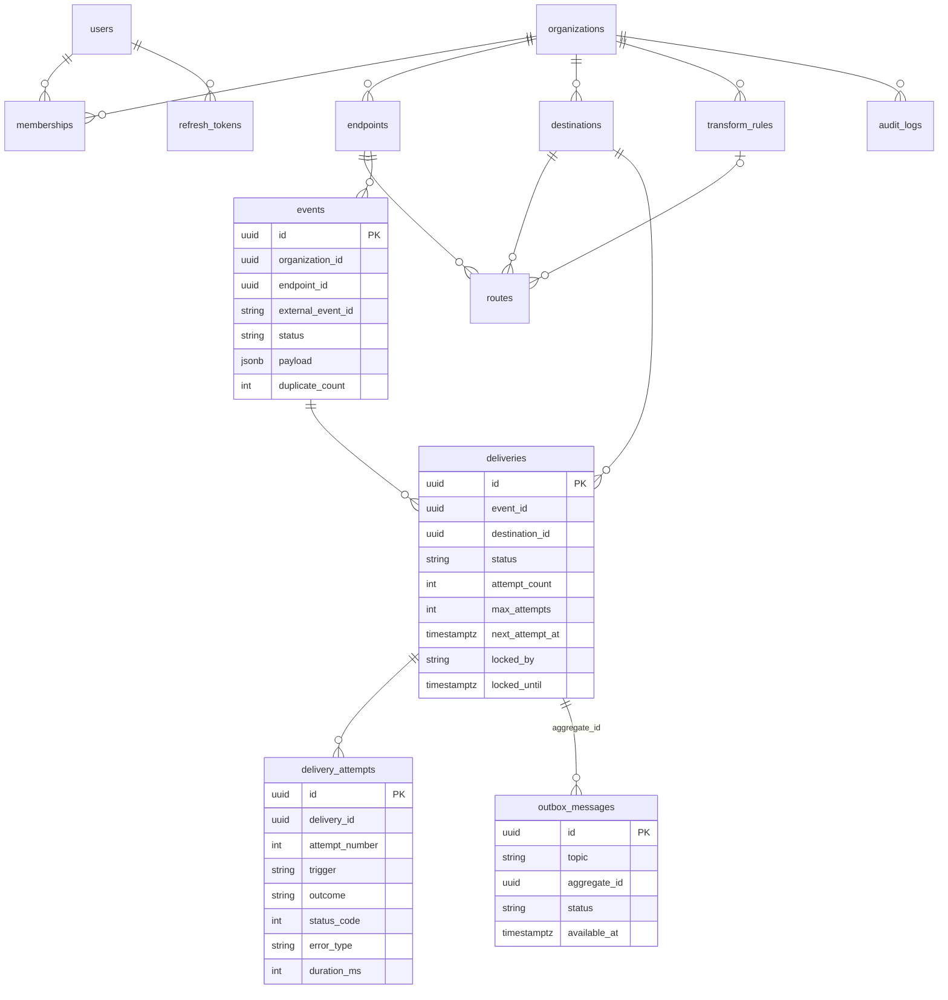
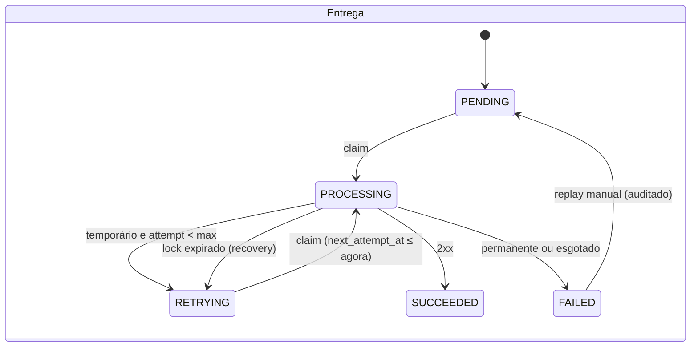

# Arquitetura do ConnectHub

## Visão geral dos componentes

| Componente | Diretório | Responsabilidade |
| --- | --- | --- |
| **API** | `backend/app` | Autenticação, autorização multi-tenant, CRUDs, ingestão pública, histórico, dashboard, replay. Nunca faz entregas HTTP. |
| **Worker** | `backend/app/worker` + `worker/Dockerfile` | Processo Celery independente: executa entregas HTTP, classifica erros e agenda retentativas. |
| **Beat** | mesmo código, comando `celery beat` | Agenda o relay do outbox (2 s) e o job de recuperação (30 s). |
| **PostgreSQL** | - | Fonte da verdade: eventos, entregas, tentativas, outbox, auditoria. |
| **Redis** | - | Broker Celery. É transporte, não estado: perder o Redis atrasa, mas não perde entregas. |
| **Simulador** | `simulator/` | Destino HTTP controlável para demonstrar falhas. |
| **Frontend** | `frontend/` | SPA Angular servida por nginx, que também faz reverse proxy de `/api` e `/sim-api`. |

O worker usa **o mesmo pacote de domínio** da API (modelos, serviços), mas roda em outro container e escala de
forma independente (`docker compose up --scale worker=3`).

## Organização do backend

```
backend/app/
├── core/          config, segurança (JWT, Argon2, Fernet, HMAC), SSRF, mascaramento, logging JSON
├── db/            engine e sessão SQLAlchemy
├── models/        modelos SQLAlchemy 2 (Mapped / mapped_column) + enums das máquinas de estado
├── schemas/       contratos Pydantic de entrada e saída
├── services/      regras de negócio sem FastAPI: ingest, transform, delivery, outbox, recovery
├── api/           dependências (auth, OrgContext, require_admin) e rotas
├── worker/        app Celery e tasks finas que delegam para services/
├── seed.py        dados de demonstração (desabilitado em produção)
└── main.py        app factory, middleware de request_id, healthchecks
```

Os serviços recebem uma `Session` ou uma `sessionmaker` e um `httpx.Client` como parâmetros. Os testes injetam
`httpx.MockTransport` e sessões reais de PostgreSQL, sem mocks de ORM.

## Modelo de dados



### Constraints e índices relevantes

| Constraint / índice | Por quê |
| --- | --- |
| `uq_event_idempotency (organization_id, endpoint_id, external_event_id)` | Chave de idempotência da ingestão. |
| `uq_delivery_event_destination (event_id, destination_id)` | Uma única entrega lógica por destino. |
| `uq_attempt_delivery_number (delivery_id, attempt_number)` | Impede duas tentativas com o mesmo número, mesmo sob concorrência. |
| `uq_route_endpoint_destination` | Evita associar o mesmo destino duas vezes ao endpoint. |
| `uq_membership_org_user`, `uq_*_org_name` | Integridade por tenant. |
| `ck_destinations_timeout_range`, `ck_destinations_max_attempts_range` | Limites validados também no banco. |
| `ix_outbox_pending_due (available_at) WHERE status='PENDING'` | Índice parcial para o relay. |
| `ix_deliveries_stuck (status, locked_until) WHERE status='PROCESSING'` | Índice parcial para a recuperação. |
| `ix_events_org_received`, `ix_deliveries_org_status`, `ix_deliveries_org_created` | Histórico e dashboard filtrados por tenant. |

A migration inicial está em `backend/alembic/versions/`. A CI roda `alembic check` para garantir que modelos e
migrations não divergem.

## Máquinas de estado

O **evento** (o que chegou) e a **entrega** (o que precisa sair para cada destino) são entidades separadas, e cada
**tentativa** é um registro próprio.



O status do **evento** é derivado das entregas: `RECEIVED` (nenhuma tentada) → `PROCESSING` / `RETRYING` →
`SUCCEEDED` (todas com sucesso) ou `FAILED` (todas finalizadas, ao menos uma falhou). `IGNORED` indica que não havia
rota ativa. As **tentativas** têm `outcome` (`IN_PROGRESS`, `SUCCESS`, `RETRYABLE_ERROR`, `PERMANENT_ERROR`) e
`trigger` (`AUTO`, `MANUAL`, `RECOVERY`).

## Concorrência e falhas

| Cenário | Como é tratado |
| --- | --- |
| Mesma mensagem consumida por 2 workers | `SELECT … FOR UPDATE SKIP LOCKED` + filtro de status: um vence, o outro retorna `skipped`. Coberto por teste com 4 threads. |
| Relay e publicação imediata publicam a mesma mensagem | Lock da linha do outbox com `SKIP LOCKED`; se ainda assim duplicar, o claim absorve. |
| API cai após o commit e antes de publicar | Outbox `PENDING` → relay publica. |
| Redis fora do ar | `publish_due` mantém `PENDING`, grava `last_error` e tenta de novo no próximo ciclo. |
| Worker morre durante o HTTP | `acks_late` reentrega a mensagem; o lock expira e o `recover` marca a tentativa como `worker_lost` e reagenda. |
| Mensagem perdida no broker | `recover` reenfileira entregas pendentes sem outbox pendente há mais de 60 s. |
| Duas entregas do mesmo evento finalizam juntas | Recalcular o status do evento exige `FOR UPDATE` na linha do evento, então as atualizações são serializadas. |
| Worker termina após perder o lock | A finalização exige `locked_by = worker`; se o lock foi perdido, só a tentativa é registrada. |

## Multi-tenancy

- As rotas privadas ficam sob `/api/v1/orgs/{org_id}/…`. A dependência `get_org_context` exige vínculo
  (`memberships`) do usuário com a organização e responde `404` caso contrário, para não revelar a existência de
  outros tenants.
- `get_owned(db, Model, id, org_id)` busca qualquer recurso por id **e** organização.
- Associações cruzadas (rota com destino ou regra de outra organização) são rejeitadas.
- `require_admin` protege configuração, segredos, membros e auditoria. OPERATOR lê e reprocessa.
- O frontend esconde ações sem permissão, mas a **autorização é sempre verificada no backend**.

## Observabilidade

- Os logs saem em JSON no stdout com `request_id` (middleware, devolvido em `X-Request-Id`), `event_id`,
  `delivery_id`, `worker_id` e `attempt`, propagados via `contextvars`.
- Os healthchecks `/health` (liveness) e `/health/ready` (PostgreSQL + Redis) alimentam o Compose.
- O dashboard mostra KPIs por período, série temporal, distribuição de estados, saúde por destino, latência média e
  quantidade de mensagens de outbox pendentes (backlog de publicação).
